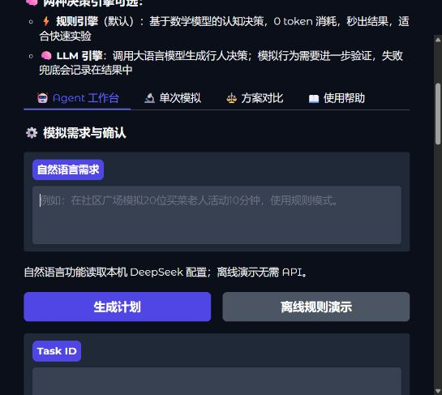
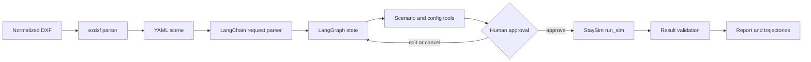
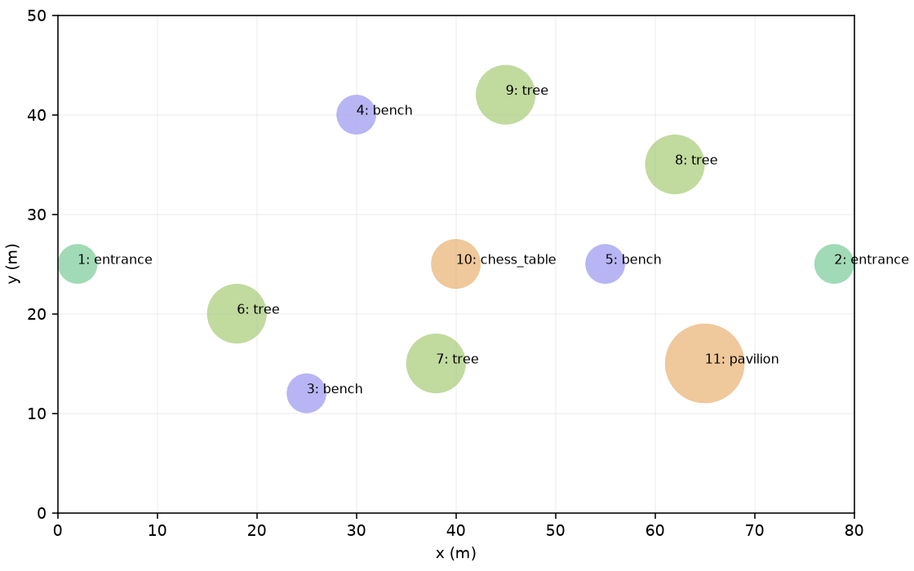
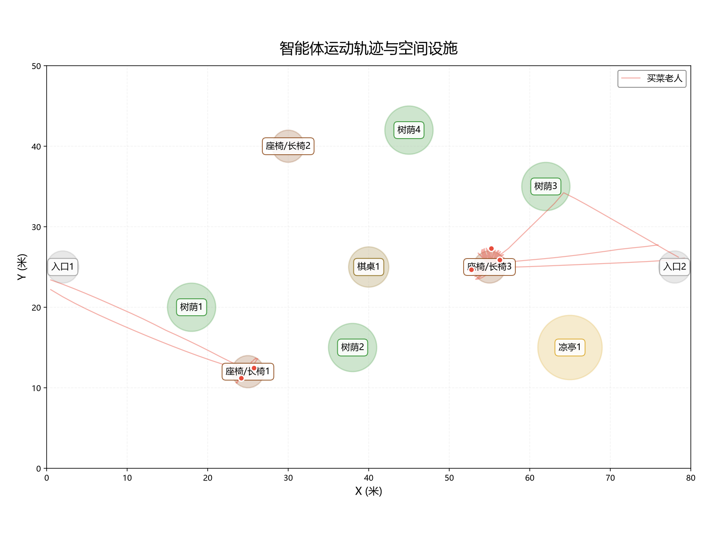

# StaySim Agent

<div align="center">

**面向规范化二维 CAD 场景的、有状态行人模拟 Agent 工作流**  
**A stateful pedestrian-simulation workflow for structured 2D CAD scenes**

`DXF` -> `YAML` -> `LangChain` -> `LangGraph` -> `Human approval` -> `StaySim`

[](https://www.python.org/)
[](https://www.langchain.com/)
[](https://www.langchain.com/langgraph)
[](https://www.gradio.app/)
[](LICENSE)

</div>

## 项目简介 | Overview

StaySim Agent 将一次自然语言模拟需求和一个规范化二维 DXF 场景，转换为可检查、可恢复、可追溯的模拟任务。LangChain 负责模型与工具接口，LangGraph 负责状态、路由、中断和恢复，StaySim 负责领域计算。

StaySim Agent turns a natural-language simulation request and a normalized 2D DXF scene into a reviewable, resumable, and traceable task. LangChain handles model and tool interfaces, LangGraph owns state and control flow, and StaySim performs the domain calculation.

> **当前边界 | Current scope:** 已验收的 DXF 链路使用确定性的规则引擎。模拟器包含 LLM 行人决策支持，但公开验收证据不宣称已完成 LLM 行为准确率评估。  
> The validated DXF path uses the deterministic rule engine. LLM pedestrian-decision support exists, but the public evidence does not claim a completed LLM behavior evaluation.



_场景导入、需求规划、人工确认和结果查看位于同一工作台。  
Scene import, planning, human approval, and result review in one workspace._

## 核心能力 | Capabilities

- **DXF 场景导入 | DXF import**：单位换算、坐标归一化、预览和 YAML 发布。  
  Unit conversion, coordinate normalization, preview, and YAML publishing.
- **结构化需求 | Structured requests**：使用 LangChain + DeepSeek 从自然语言提取可校验参数。  
  Extract validated parameters with LangChain + DeepSeek.
- **状态化流程 | Stateful workflow**：缺参追问、工具检查、人工确认、取消和恢复。  
  Clarification, preparation tools, approval, cancellation, and resume with LangGraph.
- **可靠执行 | Reliable execution**：SQLite 检查点、执行回执和重复运行保护。  
  SQLite checkpoints, execution receipts, and duplicate-run protection.
- **可追溯结果 | Traceable results**：规则模拟、结果校验、轨迹图和下载文件。  
  Rule simulation, result validation, trajectories, and downloadable artifacts.

## 快速开始 | Quickstart

```powershell
python -m venv .venv
.venv\Scripts\activate
pip install -r requirements-dev.txt
python run_agent.py --ui
```

在 Studio 中 | In the Studio:

1. 打开“场景导入”，上传 `examples/community_square_acceptance.dxf`。  
   Open **Scene import** and upload the acceptance DXF.
2. 保存规范化 YAML 场景。  
   Save the normalized YAML scene.
3. 输入：`在社区广场模拟20位买菜老人活动10分钟，使用规则模式。`  
   Enter an equivalent simulation request in English or Chinese.
4. 检查计划并明确确认。  
   Review the plan and approve it explicitly.
5. 查看校验摘要和轨迹结果。  
   Inspect the validated summary and trajectory output.

规则模式不需要行人决策 API Key；自然语言解析需要 DeepSeek Key。  
Rule-mode execution needs no pedestrian-decision key; natural-language parsing requires a DeepSeek key.

## 架构 | Architecture



| 层 / Layer | 职责 / Responsibility |
| --- | --- |
| `staysim_agent/model.py` | Prompt、结构化契约、DeepSeek 适配 / Prompt, contracts, model adapter |
| `staysim_agent/graph.py` | 节点、路由、准备循环、中断 / Nodes, routing, preparation loop, interrupts |
| `staysim_agent/tools.py` | 场景检查、参数校验、受控执行 / Inspection, validation, controlled execution |
| `staysim_agent/session.py` | SQLite 检查点、任务账本、幂等 / Checkpoints, task ledger, idempotency |
| `staysim/` | 人群、行为、时间推进、指标、DXF / Personas, cognition, stepping, metrics, DXF |
| `app.py` + `staysim_agent/ui.py` | Gradio Studio 与 Agent 工作台 / Gradio Studio and Agent workspace |

模型只能提出准备阶段工具调用，不能批准或直接执行模拟。  
The model can propose preparation tool calls, but cannot approve or directly execute a simulation.

## DXF 输入契约 | DXF Contract

导入器只接受一条可复现的二维约定：  
The importer intentionally accepts one reproducible 2D convention:

- `STAYSIM_BOUNDARY` 图层中的闭合轴对齐矩形 `LWPOLYLINE`。  
  One closed, axis-aligned rectangular `LWPOLYLINE`.
- `STAYSIM_*` 图层中的设施 `CIRCLE`。  
  Facility `CIRCLE` entities on `STAYSIM_*` layers.
- 至少一个 `STAYSIM_ENTRANCE`。  
  At least one `STAYSIM_ENTRANCE`.
- 支持米、毫米和明确的原点归一化。  
  Meter/millimeter input with explicit origin normalization.

设施圆表示作用范围，不表示碰撞几何；DWG、图片、块、任意障碍多边形、曲线和三维实体暂不支持。  
Facility circles represent activity ranges, not collision geometry. DWG, images, blocks, arbitrary polygons, curves, and 3D entities are out of scope.

详见 [DXF 输入规范 | DXF format](docs/dxf-format.md)。

| 场景预览 / Scene preview | 轨迹输出 / Trajectory output |
| --- | --- |
|  |  |

## 验收证据 | Evidence

验收场景为 80 x 50 米、11 个设施和两个入口。一次确认后的 **规则模式**运行包含 20 人、600 秒和 806 个停留事件，并生成有效结果报告；重复确认复用了原运行记录。

The acceptance scene is 80 x 50 m with 11 facilities and two entrances. A confirmed **rule-mode** run used 20 agents for 600 seconds, produced 806 stay events and a valid report, and reused the existing run on duplicate approval.

离线评估覆盖正常执行、取消、缺参、未知人群和重复确认，不产生网络调用，不能等同于 DeepSeek 准确率。  
Offline evaluation covers execution, cancellation, missing fields, unknown personas, and duplicate approval. It makes no network call and is not DeepSeek accuracy.

详见 [评估说明 | Evaluation notes](docs/evaluation.md)。

## 仓库结构 | Repository Map

```text
staysim_agent/   LangChain and LangGraph application layer
staysim/         simulation domain and DXF importer
scenarios/       small YAML demo scenes
examples/        reproducible DXF examples
scripts/         evaluation and template-generation entry points
tests/           workflow, persistence, importer, and simulation tests
docs/            architecture, input contract, and evaluation notes
```

## 配置与安全 | Configuration and Security

```text
STAYSIM_AGENT_API_KEY   outer DeepSeek request parsing
STAYSIM_AGENT_MODEL     outer model name
STAYSIM_API_KEY         inner pedestrian LLM decisions
STAYSIM_API_BASE        inner model endpoint
STAYSIM_MODEL_NAME      inner model name
```

密钥只在当前请求/进程使用，不写入图状态、SQLite 检查点或结果文件。`.env`、`config.json`、数据库、日志、虚拟环境和生成结果均被 Git 忽略。  
Keys are request-local and are not written to graph state, SQLite checkpoints, or result artifacts. Secrets and generated runtime files are ignored by Git.

## 开发与评估 | Development

```powershell
python -m pytest -q
python scripts/evaluate_agent.py
python scripts/evaluate_dxf_flow.py
```

真实 DeepSeek 评估需要显式启用 live 模式，并记录测试集、Prompt 版本、样本量、延迟和 Token。  
A live DeepSeek evaluation must be opt-in and report the test set, Prompt version, sample count, latency, and token usage.

## 后续路线 | Roadmap

- 固定并版本化自然语言评估集，比较 Prompt 版本。  
  Add a fixed, versioned natural-language evaluation set.
- 扩展 DXF 障碍物和路线约束。  
  Expand explicit obstacles and route constraints.
- 单独评估 LLM 行人决策，不与规则结果混合。  
  Evaluate LLM pedestrian decisions separately from rule results.
- 增强运行级进度与观测。  
  Improve run-level progress and observability.

## 许可证 | License

MIT，详见 [LICENSE](LICENSE)。  
MIT License. See [LICENSE](LICENSE).
