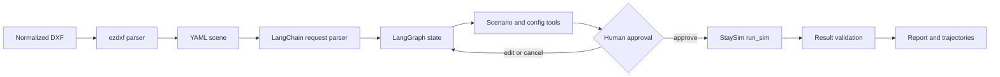

# StaySim Agent

<div align="center">

**A stateful pedestrian-simulation workflow for structured 2D CAD scenes.**

`DXF` -> `YAML` -> `LangChain` -> `LangGraph` -> `Human approval` -> `StaySim`

[](https://www.python.org/)
[](https://www.langchain.com/)
[](https://www.langchain.com/langgraph)
[](https://www.gradio.app/)
[](LICENSE)

</div>

StaySim Agent turns one natural-language simulation request and one normalized 2D DXF scene into a reviewable, resumable, and traceable simulation task. LangChain handles model and tool interfaces; LangGraph owns state, routing, interrupts, and recovery; StaySim performs the domain calculation.

> **Current scope:** the validated DXF acceptance path uses the deterministic rule engine. LLM pedestrian-decision support exists in the simulator, but the public acceptance evidence does not claim a completed LLM behavior evaluation.


_A single workspace for scene import, planning, approval, and result review._

## What It Demonstrates

- Deterministic DXF parsing with unit conversion, coordinate normalization, preview, and YAML publishing.
- Structured request extraction with LangChain and DeepSeek.
- LangGraph workflow control: missing-field clarification, preparation tools, human approval, cancellation, and resume.
- SQLite checkpoints, execution receipts, and duplicate-run protection.
- StaySim rule simulation with validated reports, trajectories, and downloadable artifacts.

## Quickstart

```powershell
python -m venv .venv
.venv\Scripts\activate
pip install -r requirements-dev.txt
python run_agent.py --ui
```

In the Studio:

1. Open **Scene import** and upload `examples/community_square_acceptance.dxf`.
2. Save the normalized YAML scene.
3. Create a request such as `在社区广场模拟20位买菜老人活动10分钟，使用规则模式。`.
4. Review the generated plan and approve it explicitly.
5. Inspect the validated summary and trajectory output.

Rule-mode execution does not need a pedestrian-decision API key. Natural-language parsing needs a DeepSeek key supplied through the current process or the Studio API configuration panel.

## Architecture



| Layer | Responsibility |
| --- | --- |
| `staysim_agent/model.py` | Prompt, structured request contracts, DeepSeek model adapter |
| `staysim_agent/graph.py` | Nodes, conditional edges, preparation loop, interrupts |
| `staysim_agent/tools.py` | Scenario inspection, validation, controlled execution, result checks |
| `staysim_agent/session.py` | SQLite checkpoints, task ledger, usage observation, idempotency |
| `staysim/` | Personas, cognition, time stepping, metrics, results, DXF import |
| `app.py` and `staysim_agent/ui.py` | Gradio Studio and Agent workspace |

The model can propose preparation tool calls, but it cannot approve or directly execute a simulation. The approved execution path is controlled by the graph and the session ledger.

## DXF Contract

The importer intentionally accepts one reproducible 2D convention:

- One closed, axis-aligned rectangular `LWPOLYLINE` on `STAYSIM_BOUNDARY`.
- Facility `CIRCLE` entities on `STAYSIM_*` layers.
- At least one `STAYSIM_ENTRANCE`.
- Meter and millimeter input with explicit scale and origin normalization.

Facility circles represent attraction or activity ranges, not collision geometry. DWG, images, blocks, arbitrary obstacle polygons, curves, and 3D entities are outside the current contract. See [docs/dxf-format.md](docs/dxf-format.md).

| Scene preview | Trajectory output |
| --- | --- |
|  |  |

## Evidence and Boundaries

The acceptance scenario is an 80 x 50 m scene with 11 facilities and two entrances. A confirmed 20-person, 600-second **rule-mode** run produced 806 stay events and a valid result report. Duplicate approval reused the existing run instead of executing the simulator again.

Offline workflow evaluation covers normal execution, cancellation, missing fields, unknown personas, and duplicate approval. It makes no network call and must not be presented as DeepSeek accuracy. See [docs/evaluation.md](docs/evaluation.md).

## Repository Map

```text
staysim_agent/   LangChain and LangGraph application layer
staysim/         simulation domain and DXF importer
scenarios/       small YAML demo scenes
examples/        reproducible DXF template and acceptance scene
scripts/         evaluation and template-generation entry points
tests/           workflow, persistence, importer, and simulation regression tests
docs/            architecture, input contract, and evaluation notes
```

## Configuration and Security

```text
STAYSIM_AGENT_API_KEY   outer DeepSeek request parsing
STAYSIM_AGENT_MODEL     outer model name
STAYSIM_API_KEY         inner pedestrian LLM decisions
STAYSIM_API_BASE        inner model endpoint
STAYSIM_MODEL_NAME      inner model name
```

Keys are request-local and are not written to graph state, SQLite checkpoints, or result artifacts. `.env`, `config.json`, databases, logs, virtual environments, and generated output are ignored by Git.

## Development

```powershell
python -m pytest -q
python scripts/evaluate_agent.py
python scripts/evaluate_dxf_flow.py
```

For a real DeepSeek parser evaluation, opt in explicitly with the evaluator's live mode. It can incur provider cost and does not approve or run simulations automatically.

## Roadmap

- Add a fixed, versioned natural-language evaluation set with reproducible Prompt comparisons.
- Expand the DXF contract to represent explicit obstacles and route constraints.
- Add a separately reported LLM pedestrian-decision evaluation.
- Improve run-level progress and observability without changing the domain engine contract.

## License

MIT. See [LICENSE](LICENSE).
