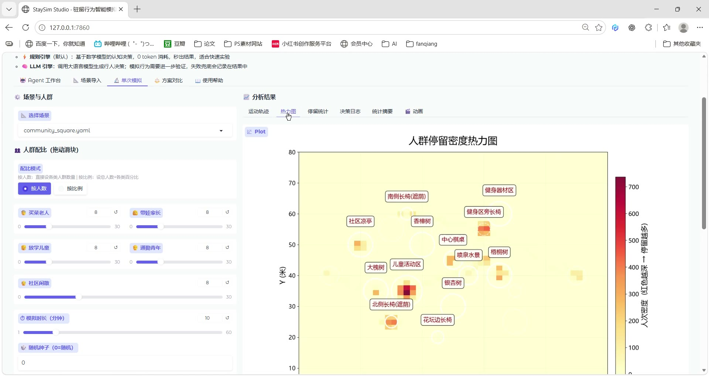
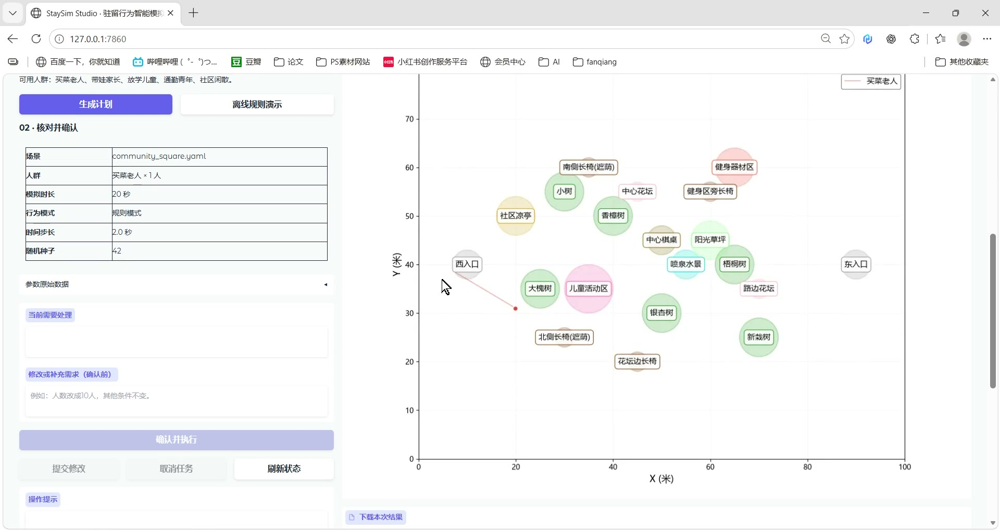

# StaySim 演示视频 | Video demos

两段视频均为用户提供的本地 StaySim Studio 屏幕实录。点击封面前往个人作品集，使用播放器观看；也可直接下载仓库中的 MP4。

Both recordings were supplied by the project author from the local StaySim Studio. Follow a poster to the portfolio's video player, or download the MP4 files directly from this repository.

## 模拟分析演示 | Simulation & analysis

- **观看 | Watch:** [在线播放](https://zz-xun.github.io/#demo-product) · [MP4 文件](staysim-product-demo.mp4)
- **内容 | Content:** 人群配置、历史结果回放、分析图与动画导出界面。 / Population settings, history playback, analysis charts, and the animation-export interface.
- **时长 | Duration:** 40.681 秒 / seconds.
- **源文件 | Source filename:** `AI产品demo.mp4`.

## Agent 工作台演示 | Agent workspace

- **观看 | Watch:** [在线播放](https://zz-xun.github.io/#demo-agent) · [MP4 文件](staysim-agent-demo.mp4)
- **内容 | Content:** 需求填写、离线规则演示、计划确认与结果查看。 / Request entry, an offline rule-mode demo, plan approval, and result review.
- **时长 | Duration:** 118.538 秒 / seconds.
- **源文件 | Source filename:** `demo1.mp4`.

## 文件说明 | File notes

视频完整保留原有 H.264 视频流与 AAC 音轨、1920 × 1020 分辨率和时长，没有剪辑或重新压缩。发布副本仅将 MP4 索引移至文件开头，便于网页渐进播放；两张封面直接取自各自视频。视频中的规则模式结果用于展示操作流程，不构成 LLM 行为准确率的评估证据。

The published copies retain the full original H.264 video and AAC audio streams, 1920 × 1020 resolution, and duration, without cuts or re-encoding. Only the MP4 index is moved to the beginning for progressive web playback. Both posters are frames from their respective recordings. Rule-mode results in the recordings demonstrate the workflow and are not an evaluation of LLM behavior accuracy.
